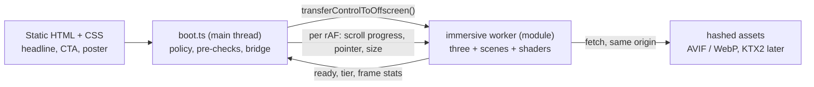

# ADR-005: Immersive 3D layer — engine, loading, device tiers, fallbacks, budgets

| Field | Value |
|-------|-------|
| Status | Proposed — accepted when this PR merges. Partly supersedes [ADR-004](ADR-004-motion-and-effects.md) (see §11) |
| Date | 2026-10-30 |
| Deciders | tech-lead (author) · owner (@MohammedAbdulFarhan08) final say |
| Traces to | `docs/product/BRIEF.md` → "Change request 2" · [immersive references](../design/research/immersive-references.md) · [ADR-001](ADR-001-stack.md) · [nfr.md](../architecture/nfr.md) P-1…P-14, SEC-1 · issue #109 |
| Evidence | [Engine bundle sizes, measured](../engineering/evidence/adr-005-engine-sizes.md) |

## Context
Change request 2 lifts the 29 October limits (35 kB script, 15 kB hero, no 3D library). The home page
becomes one continuous real-time 3D world the camera moves through on scroll; each service is a
transformation of one system; the UI (shader text, magnetic CTAs, transitions, optional sound)
belongs to the world. At the same time the headline and CTA must paint at once as HTML/CSS, Lighthouse
mobile must stay ≥ 90 on home and service pages (≥ 95 elsewhere), the frame rate must hold on
mid-range devices, and every visitor who cannot or should not run 3D gets a beautiful static render.

Fixed constraints that do not move: Astro static output (ADR-001), CSP `script-src 'self'` with no
inline scripts and no `eval` (SEC-1), zero third-party requests, portability (rule 6), and the 8 GB
WSL build machine.

## Options considered
Sizes are **measured** from a real Vite 8.3.5 production build on 2026-10-30, gzip -9 (Brotli in
brackets); method and raw numbers in the [evidence file](../engineering/evidence/adr-005-engine-sizes.md).

| Option | Version | Realistic scene, compressed | Notes |
|--------|---------|-----------------------------|-------|
| **A. three.js, WebGL2 renderer, tree-shaken** | 0.187.0 | core scene 127.7 kB (104.9); with GLTF/KTX2/Meshopt loaders + bloom 199.8 kB (164.6) | Largest ecosystem: post passes, `GPUComputationRenderer` (GPGPU particles), `MeshSurfaceSampler` (particle morph targets). Works in a worker with `OffscreenCanvas`. Monthly releases with breaking changes between minors. |
| **B. three.js WebGPU build** (`three/webgpu`, WebGL2 backend fallback) | 0.187.0 | 211.6 kB (171.6) for one node material | Compute shaders and TSL; one engine for both APIs. +84 kB over A before any scene, shaders in TSL not GLSL, two GPU back ends to test. |
| **C. OGL** | 1.0.11 | 22.9 kB (19.7) for the same scene | Tiny, close to raw WebGL. No KTX2, no GPGPU helper, minimal post-processing; we would write and own those. One main maintainer, small community. |
| **D. Raw WebGL2** | — | 0 kB library; our own code | Full control, smallest. We would build a mini-engine (scene graph, loaders, post chain, resource lifetime) — weeks of work and a permanent maintenance load. |
| **E. React Three Fiber** | 9.8.2 (+ React 19.3.1) | 299.6 kB (230.1) for one mesh | Needs React and `@astrojs/react` on top of ADR-001's zero-framework stack; React reconciler on the main thread works against our TBT budget; renders on the main thread by default. Does not fit the stack. |

Also rejected without a build: Babylon.js (far above the 400 kB budget for our needs), PlayCanvas
engine (editor-centred workflow), Spline/Unicorn-style hosted runtimes (host lock-in, third-party JS).

### Scored matrix (1 = poor, 5 = best; weight in brackets)
| Criterion | A three WebGL2 | B three WebGPU | C OGL | D raw WebGL2 | E R3F |
|-----------|:-:|:-:|:-:|:-:|:-:|
| Fits budgets with room for scenes (×3) | 4 | 3 | 5 | 5 | 2 |
| Can deliver the CR2 look: GPGPU particles, morphing, bloom, shader text (×3) | 5 | 5 | 3 | 3 | 5 |
| Runs off the main thread in a worker (×2) | 5 | 4 | 4 | 5 | 2 |
| Maturity, docs, people and agents who know it (×2) | 5 | 3 | 2 | 2 | 4 |
| Fits ADR-001 stack and CSP, no new framework (×2) | 5 | 4 | 5 | 5 | 1 |
| Effort to build and maintain (×2) | 4 | 3 | 3 | 1 | 4 |
| Portability / lock-in (×1) | 5 | 5 | 5 | 5 | 4 |
| Test surface (one GPU path) (×1) | 5 | 2 | 5 | 5 | 4 |
| **Weighted total (max 80)** | **75** | **59** | **62** | **60** | **51** |

## Decision
### 1. Engine
**three.js, `WebGLRenderer` on WebGL2, tree-shaken, pinned to an exact version** (`"three": "0.187.0"`,
no caret — three breaks APIs between minors). Upgrades are deliberate PRs that pass the visual
regression check (§9). Only named imports from `three` and `three/addons/*`; no `import * as THREE`.

**WebGPU is not used in v1.** WebGL2 is the baseline everywhere. Revisit (new ADR) when a scene needs
compute that WebGL2 GPGPU cannot do inside the frame budget; the move stays inside three
(`three/webgpu`), so scenes and assets survive it. GLSL shaders written now port to TSL by hand.

No `postprocessing` package (it lags three: `peer three < 0.187.0`); use three's own passes or one
hand-written combined post shader. No `detect-gpu` (it fetches tables from unpkg at run time); tier
detection is first-party (§4).

### 2. Architecture: render in a worker

- **Main thread:** `src/scripts/immersive/boot.ts` (≤ 8 kB). It runs the policy (§5), cheap
  pre-checks, creates the canvas, transfers it with `transferControlToOffscreen()`, starts a
  same-origin **module worker** (`new Worker(new URL('./worker.ts', import.meta.url), { type: 'module' })`)
  and, on each `requestAnimationFrame`, posts `{ progress 0→1, section, pointer, viewport }`. The
  worker renders one frame per tick, so scroll and frame stay in step and no worker `rAF` support is
  needed. No `SharedArrayBuffer` (it would need COEP).
- **Worker:** `src/scripts/immersive/worker.ts` + `scenes/<name>.ts` + `shaders/*.glsl` (imported
  `?raw`). Engine parse, scene build, shader compile and rendering never block the main thread, which
  is what keeps TBT and INP inside budget while 400 kB of 3D loads.
- **No `OffscreenCanvas` WebGL2 → static render** (tier 0). Supported in Chrome/Edge 69+, Firefox 105+,
  Safari 17+, i.e. all of nfr.md §5. One render path, one test path.
- DOM stays the source of truth: all text, links and CTAs are real HTML. Magnetic CTAs, cursor
  response in the DOM and section state remain the ADR-004 motion controller's job (CSS transforms).
- **Page transitions:** cross-document View Transitions (`@view-transition { navigation: auto; }`,
  CSS only). Each page boots its own world; the engine chunk is cached by HTTP. No SPA router.
- **Sound:** off by default, a visible toggle (real `<button aria-pressed>`); Web Audio code and
  audio files load only after the visitor turns it on; the choice is kept in `sessionStorage`.

### 3. Loading sequence
1. **First paint is HTML/CSS only:** headline, text, CTA and the static poster of the world (a
   `<picture>` AVIF/WebP render of the same scene, explicit size, `fetchpriority="low"`, ≤ 100 kB on
   phones so the headline stays the LCP element). Before the 3D starts the page loads ≤ 50 kB of
   script in total (controller + boot + any page script).
2. **Start condition:** after the `load` event **and** the first `requestIdleCallback` (timeout
   2 s; `setTimeout` fallback for Safari) **and** the policy allows 3D (§5). LCP has already happened.
3. Boot posts pre-check results; the worker imports the engine and the **first scene only**, creates
   a WebGL2 context with `failIfMajorPerformanceCaveat: true`, classifies the tier (§4) and loads that
   tier's assets.
4. **Shader compilation off the critical path:** `renderer.compileAsync(scene, camera)` (uses
   `KHR_parallel_shader_compile`) before the first visible frame; next-section materials compile while
   idle, never during a scroll frame.
5. The canvas fades in over the poster (opacity, ≤ 600 ms) only when the first frame is ready. If any
   step fails or takes longer than 8 s, the poster stays and the worker is terminated — no error UI,
   no layout shift (the canvas box is reserved by CSS from the start).
6. Later scenes load with dynamic `import()` one section ahead of the camera.

### 4. Device tiers
Detection is first-party (≤ 3 kB): main-thread pre-checks (policy, `OffscreenCanvas`, `deviceMemory`,
`hardwareConcurrency`, `pointer: coarse`, viewport) + in-worker checks (WebGL2 with
`failIfMajorPerformanceCaveat`, `UNMASKED_RENDERER_WEBGL` against a small software-renderer list —
SwiftShader, llvmpipe, Microsoft Basic Render — `MAX_TEXTURE_SIZE`) + a 30-frame warm-up probe.

| Tier | Who | DPR cap | GPU particles | Post-processing | Assets (compressed) |
|------|-----|:-:|:-:|---|:-:|
| 0 — static | Policy says no (§5), no `OffscreenCanvas`/WebGL2, software renderer, performance caveat, `deviceMemory` < 4, or probe p90 > 50 ms | — | — | — (static poster per section) | posters only |
| 1 — phone / low | Coarse pointer or ≤ 4 cores, probe p90 ≤ 33 ms | 1.5 | ≤ 30 k | One combined pass: grain + vignette + tone map; no bloom | ≤ 800 kB |
| 2 — mid | Desktop integrated GPU or high-end phone, probe p90 ≤ 16 ms | 1.75 | ≤ 120 k | Half-resolution bloom + combined pass | ≤ 2 MB desktop / ≤ 800 kB phone |
| 3 — high | Discrete or Apple-silicon GPU, probe p90 ≤ 8 ms | 2 | ≤ 400 k | Bloom, chromatic aberration, depth of field (as the design asks) | ≤ 2 MB |

**Adaptive quality:** the worker tracks frame time over 2 s windows; if p90 exceeds the tier target
(16.7 ms for tiers 2–3, 33 ms for tier 1) it steps down one tier (DPR first, then particles, then
post). It never steps up during a visit. Two step-downs below tier 1 → static poster.
Scroll frames target ≤ 4 ms of CPU work in the worker. A URL flag `?tier=0..3` forces a tier for
QA and CI (§9); it can only lower or force, never bypass the policy.

### 5. Policy and static fallback
The ADR-004 §3 motion policy is the single gate. **No 3D layer is requested** when any of these hold:
`prefers-reduced-motion: reduce`, `navigator.connection.saveData`, `effectiveType` `slow-2g`/`2g`/`3g`,
JavaScript disabled, tier 0. Those visitors get the **static render**: art-directed AVIF/WebP posters
of the same world for the hero and each service section (rendered from the real scene by the
designer/engineers, not stock), in normal `<picture>` elements, with all content and the form usable
without JavaScript. The sound toggle is hidden when 3D is off.

### 6. Pausing
`visibilitychange` (hidden) and an `IntersectionObserver` on the canvas host stop the main-thread
ticks, so the worker renders nothing; after 30 s off-screen the worker drops GPU buffers it can
rebuild. `webglcontextlost` → show the poster; restore on `webglcontextrestored`.

### 7. Assets
| Kind | Format now | Later (needs §8 CSP change) |
|------|-----------|------------------------------|
| Geometry | Procedural in code (gears, vane, particle fields, morph targets sampled at run time); small glTF only if needed, uncompressed `.glb` ≤ 150 kB | Meshopt-compressed glTF |
| Textures | AVIF/WebP via `ImageBitmapLoader` (works in workers), power-of-two, ≤ 2048 px (≤ 1024 px tier 1) | KTX2 / Basis Universal (UASTC for normals, ETC1S for colour) |
| Environment / lighting | Baked gradients and small HDR-less env maps generated in shader | KTX2 cube maps |
| Audio | Opus in WebM + AAC fallback, loaded only on toggle, ≤ 300 kB, outside the tier asset budget | — |
| Posters | AVIF + WebP, sizes per breakpoint | — |
Assets live in `src/assets/immersive/` and are imported with `?url` so Vite hashes them (long cache).

### 8. CSP compatibility
With §7 "now", **SEC-1 does not change**: the module worker is same-origin, so `worker-src` falls
back to `script-src 'self'`; shaders are strings in hashed JS; no inline scripts, no `eval`/`new
Function` (verified in the three and OGL build output); assets come from `'self'`
(`connect-src`/`img-src`). `vite.build.assetsInlineLimit: 0` (ADR-004 §7) stays, so the worker is a
file, not a `data:`/`blob:` URL.
Adopting KTX2 or Meshopt later needs WebAssembly and three's Blob-URL transcoder worker, i.e.
`script-src 'self' 'wasm-unsafe-eval'` and `worker-src 'self' blob:`. That is a separate,
`security-sensitive` PR that updates the threat model, and only when the asset budget proves it is
needed. `'unsafe-eval'` is never added.

### 9. Testing and CI
| Check | Job | What it proves |
|-------|-----|----------------|
| **Size budgets per chunk** over `dist/` (Vitest under `tests/unit/build/`, gzip -9): pre-3D script per page ≤ 50 kB; `boot` ≤ 8 kB; engine + worker + all scene chunks ≤ 400 kB; tier asset manifests ≤ 800 kB / 2 MB; fails naming the chunk | `unit` (after `build`) | Budgets in nfr.md P-4, P-12 |
| `dist/` HTML scan (ADR-004 §8): no inline `<script>`, no `on*=`, no `style=`; no `blob:`/`data:` worker URLs in JS | `unit` | CSP |
| **Lighthouse CI**, mobile, median of 3: home + service pages perf ≥ 0.90, all other categories and pages ≥ 0.95, LCP ≤ 2.5 s, CLS ≤ 0.05, TBT ≤ 150 ms. Runs with the default policy — headless Chromium has a software GPU, so it measures the **static path** | `lighthouse` (#100) | P-1…P-3, L-1…L-4 |
| **Lighthouse with 3D forced:** home at `/?tier=1`, same thresholds | `lighthouse` (#100) | Loading the 3D after LCP does not hurt TBT/LCP/CLS |
| **Frame-time smoke test:** Playwright, headless Chromium with SwiftShader, `/?tier=1&stats=1`, scripted scroll top → bottom; the worker posts frame stats. Assert: canvas ready < 8 s, no main-thread long task > 50 ms during scroll, worker CPU per frame p95 ≤ 12 ms, no console errors. Absolute fps is not asserted in CI (no real GPU) | `e2e` | Frame budget regressions, scroll jank |
| **Canvas visual regression:** `/?tier=1&still=<t>` renders a deterministic frame (fixed seed, fixed time, DPR 1) at three scroll positions; `toHaveScreenshot` with `maxDiffPixelRatio: 0.02` | `e2e` | Scene and three-upgrade regressions |
| **Fallbacks:** Playwright with `reducedMotion: 'reduce'`, with `--disable-webgl`, and with JavaScript disabled on home + one service page: no request for the engine/worker chunks (network assertion), posters visible, content and form usable, axe passes, screenshot of the static render | `e2e` | P-10, P-13 |
| **Real-device frame rate:** 60 fps mid-range laptop, ≥ 30 fps mid-range Android, checked with the `?stats=1` overlay before each release and on Gate 2c prototypes | Release checklist (manual) | P-12 |

The `e2e` job runs one headless browser at a time (8 GB machine). The `?still`, `?stats` and `?tier`
flags are read-only display switches, documented, and have no effect on content.

### 10. Code location and rules
`src/scripts/immersive/` — `boot.ts`, `policy.ts` (shared with the motion controller), `tier.ts`,
`worker.ts`, `scenes/`, `shaders/`, `audio/`. No host-specific code. Every scene exports `build`,
`update(progress, pointer, dt)`, `setTier`, `dispose`; resources are disposed when a scene leaves.
Text stays in the DOM; shader text effects draw decorative copies on the canvas with the DOM text
always present for assistive tech and never hidden before the effect is ready.

### 11. What this supersedes in ADR-004
| ADR-004 | Now |
|---------|-----|
| §1.3 hero renderer ≤ 15 kB, Canvas 2D default | Replaced by this ADR's immersive layer |
| §2 budget table (35 kB / 15 kB) | Replaced by nfr.md P-4 and P-12 |
| §5 "no 3D / animation libraries" | three.js allowed as decided here; other libraries still need an ADR |
| §8 budgets in the size check; §9 feasibility input | Replaced by §9 here |
| §1.1–1.2, §3 policy, §4 techniques for DOM motion, §6 accessibility, §7 CSP | **Still in force** |

## Consequences
- **Positive:** the CR2 look is buildable with a mainstream engine; the main thread keeps only
  ~50 kB, so first paint and INP stay protected; one render path (WebGL2 in a worker) and one
  fallback path keep testing small; no CSP change now.
- **Negative:** ~128 kB gzip of engine before any scene; worker messaging adds one frame of latency
  between scroll and camera (acceptable; DOM text scrolls natively); exact-version pinning means a
  planned upgrade every few months; Lighthouse alone cannot see the 3D path, hence the forced-tier run
  and the manual device check; posters must be re-rendered when a scene changes.
- **Follow-up tickets (EM creates them):** (1) `ci` size and HTML-scan checks + LHCI thresholds per
  §9; (2) `test(e2e)` fallback, visual regression and frame-time specs; (3) `feat(immersive)` boot,
  policy, tier detection and worker skeleton with one test scene — Depends on (1); (4) scenes per the
  Gate 2c concept — Depends on (3) and Gate 2c.

## How we would migrate away
Scenes talk to the engine only inside `worker.ts` and `scenes/`; the boot/bridge protocol
(`progress`, `pointer`, `viewport`, `tier`) is engine-neutral. Moving to OGL or raw WebGL2 (smaller)
or `three/webgpu` means rewriting `scenes/` and the post chain, not the pages, the policy, the
fallback or the CI checks. Dropping 3D entirely is a one-line policy change: every page already works
with the static render.
