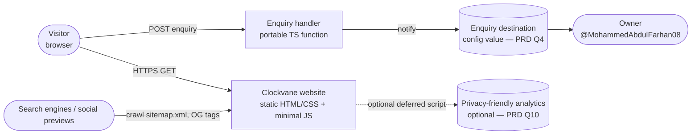
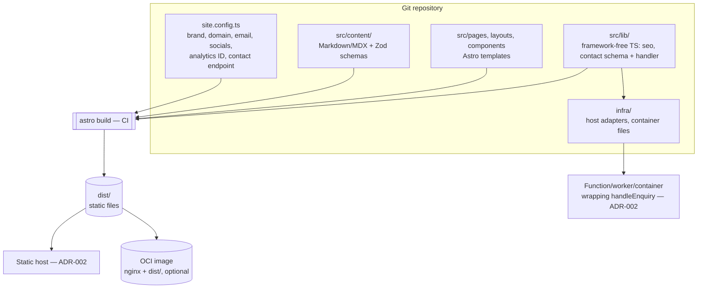

# Architecture overview — Clockvane website

| Field | Value |
|-------|-------|
| Owner | tech-lead |
| Status | Proposed (Gate 2 input) |
| Last updated | 2026-10-22 |
| Decisions | [ADR-001 stack](../adr/ADR-001-stack.md) · [ADR-002 hosting](../adr/ADR-002-hosting.md) |
| Related | [NFRs](nfr.md) · [Engineering standards](../engineering/standards.md) |

## 1. Context (C4 level 1)


## 2. Containers (C4 level 2)


The site is two deployables: **static files** (all pages) and **one small handler** (enquiries).
Both are host-agnostic: the handler is `handleEnquiry(request: Request): Promise<Response>` using
only web-standard `Request`/`Response`/`fetch`; each host adapter in `infra/` is a few lines that
call it.

## 3. Repository layout
```
site.config.ts            # the ONLY place for brand/domain/email/phone/socials/analytics IDs
astro.config.mjs          # reads site URL from site.config.ts; output: 'static'
src/
  pages/                  # routes only; thin, compose layouts + components
  layouts/                # BaseLayout (head/SEO/landmarks), PageLayout, ServiceLayout
  components/
    ui/                   # design-system primitives (Button, Link, Field, Card…)
    sections/             # page sections (Hero, ServiceList, ProcessSteps, CtaBand…)
    proof/                # empty-safe proof components (render nothing without data)
  content/                # collections: services/, pages/, faq/, proof/ (+ blog/ later)
  content.config.ts       # Zod schemas for every collection
  lib/
    seo/                  # title/description/canonical/JSON-LD builders
    contact/              # schema.ts (shared Zod), handler.ts (pure), spam.ts
    config/               # typed accessors around site.config.ts
  styles/                 # tokens.css (generated from docs/design), base.css, utilities.css
  scripts/                # tiny progressive-enhancement scripts (form validation)
public/                   # robots.txt template, favicons, static OG fallback
tests/
  unit/                   # Vitest
  e2e/                    # Playwright + axe
infra/                    # host adapters + Dockerfile/nginx.conf (ADR-002); never imported by src/
.github/workflows/        # CI/CD; host specifics here, not in src/
docs/                     # product, design, content, adr, architecture, engineering
```

## 4. Rendering strategy
- Every v1 page is **pre-rendered at build time** (`output: 'static'`). No client-side routing.
- JavaScript is opt-in per component. v1 expects exactly one script: the contact-form enhancement
  (inline validation, async submit, success/error states). Everything else is HTML + CSS.
- Mobile navigation uses a no-JS pattern (`<details>`/disclosure or CSS), enhanced only if needed.
- Proof, FAQ and other optional sections are **empty-safe**: if their collection is empty, they do
  not render and their pages are excluded from the build and sitemap (FR-5).
- There is one artifact for every environment (no env flags in the build). Preview and staging get `noindex` through
  the `X-Robots-Tag` header and a disallow-all `robots.txt` that the deploy step swaps in (NFR-SEO-2; ADR-002).

## 5. Content model
Collections are typed with Zod in `src/content.config.ts`; the build fails on invalid content.

| Collection | Key fields | Notes |
|------------|------------|-------|
| `services` | `slug`, `title`, `summary`, `problem`, `chores[]`, `deliverables[]`, `engagement`, `seo{title,description}`, `order` | One repeatable structure, so a 6th service is one file (FR-6) |
| `pages` | `slug`, `title`, `seo`, body (MDX) | Home/About/How we work/Privacy body copy from the copy deck |
| `faq` | `question`, `answer`, `order` | Section or page (p2) |
| `proof` | `type: testimonial \| project \| logo`, `source`, `permission: true` (required) | Empty by default; `permission` must be literally `true` (CR-2) |

Placeholders `[[PLACEHOLDER: …]]` are allowed in drafts; a CI check fails the **production** build if
any remain (Gate 3 rule).

## 6. Configuration and environments
- **`site.config.ts`** (committed, no secrets): `brand { name, tagline }`, `url` (canonical origin),
  `contact { email?, phone?, endpoint, fallbackMethods[] }`, `socials[]`, `analytics { provider?, id? }`,
  `legal { companyName?, address? }`. Validated by a Zod schema at build; values that are not yet
  known are `undefined` and components hide them.
- **Env vars** (set in CI/host, never in repo): `SITE_URL_PRODUCTION`, read only by `site.config.ts`
  (falls back to a default defined in that file), and handler secrets (e.g. notification token)
  read only by the adapter in `infra/` and passed into `handleEnquiry` as arguments.
- `.env*` files are never committed or read by agents (CLAUDE.md rule 7).
- Domain change = edit `url` in `site.config.ts` + redirects in `infra/` (NFR-PORT-2, NFR-SEO-5).

## 7. Cross-cutting concerns
- **SEO:** `BaseLayout` requires `title` and `description` props (type error if missing) and emits
  canonical, OG/Twitter tags and JSON-LD from `src/lib/seo/`. `@astrojs/sitemap` generates the
  sitemap; a CI test asserts unique titles/descriptions across `dist/`.
- **Security:** headers (CSP, HSTS, etc., see `nfr.md`) are defined once in `infra/headers` and applied
  by each host adapter; no inline scripts except hashed ones, so a strict CSP is possible.
- **Errors:** custom `404.astro`; form shows field errors, a network-error state and a fallback
  contact method from config.

## 8. Growth path (no rewrite)
| Future need | How it fits |
|-------------|-------------|
| Blog / insights | New `blog` collection + `/blog/[slug]` route; RSS via `@astrojs/rss`. Still static |
| Case studies | Promote `proof` entries of type `project` to a `case-studies` collection with its own layout |
| i18n | Astro i18n routing (`/en/…`, `/de/…`), per-locale content folders; `site.config.ts` gains `locales` |
| Headless CMS | Swap the collection source for a content loader; Zod schemas and pages unchanged |
| Client portal / app | Separate app (own ADR) on a subdomain, or per-route server rendering with the Node adapter running in the OCI image. Marketing pages stay static |
| API | Further pure handlers in `src/lib/` exposed via the same adapter pattern, or a separate service; shared types via a `packages/` workspace if the repo becomes a monorepo |

## 9. Open items
- ADR-002: static host, where `handleEnquiry` runs, preview deploys, headers application.
- PRD Q4 (enquiry destination) and Q10 (analytics) set config values only; no architecture change.
