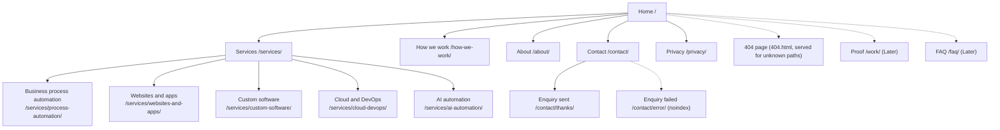

# Sitemap

Status: draft for Gate 2 · Owner: UX/UI Designer · Ticket: #12
Inputs: `docs/product/PRD.md` (sections 5, 6, 8), `docs/product/personas.md`, `docs/product/success-metrics.md`.
Flows and navigation diagrams: `user-flows.md`.

Personas: **P1** owner-operator, **P2** ops/IT manager, **P3** technical founder.
Tags: **MVP** = p0/p1 in the PRD, needed for go-live. **Later** = p2/p3.
The one primary CTA label site-wide is **"Book a free audit call"** (PRD section 6). On the Contact page the submit button reads "Send message".

## Structure

Two-click rule (FR-8): every page is reachable from Home in at most two clicks. Service detail pages are two clicks (Home, Services, detail), and also reachable from Home's service list in one.

URL rules (NFR-SEO-5): lowercase, hyphenated, trailing slash, no dates or IDs. Slugs are stable so a domain change needs only redirects.

## Page inventory

| Page | URL | Purpose | Persona | Primary CTA | Tag |
|------|-----|---------|---------|-------------|-----|
| Home | `/` | Say what Clockvane does, for whom and the next step in under 10 s; route to services; show the way of working; repeat the CTA | P1, P2, P3 | Book a free audit call | MVP (p0) |
| Services overview | `/services/` | Explain all five services in concrete terms; link to detail | P1, P2 | Book a free audit call | MVP (p0) |
| Business process automation | `/services/process-automation/` | Named chores that get automated, deliverables, how an engagement runs | P1 | Book a free audit call | MVP (p1) |
| Websites and apps | `/services/websites-and-apps/` | Site or app scope, deliverables, performance and accessibility stance | P1, P3 | Book a free audit call | MVP (p1) |
| Custom software | `/services/custom-software/` | When off-the-shelf does not fit; deliverables, ownership of code | P2, P3 | Book a free audit call | MVP (p1) |
| Cloud and DevOps | `/services/cloud-devops/` | Delivery pipelines, cloud setup and cost, security and handover | P2, P3 | Book a free audit call | MVP (p1) |
| AI automation | `/services/ai-automation/` | Targeted AI steps in real workflows, human checks, risk | P2, P1 | Book a free audit call | MVP (p1) |
| How we work | `/how-we-work/` | Steps from first call to delivery, engagement models, pricing stance (CR-4) | P1, P2 | Book a free audit call | MVP (p1) |
| About | `/about/` | Who is behind Clockvane, name story, expertise. Owner-supplied facts only | P1, P3 | Book a free audit call | MVP (p1) |
| Contact | `/contact/` | The conversion page: enquiry form, fallback contact method, response-time promise | All | Send message | MVP (p0) |
| Enquiry sent | `/contact/thanks/` | On-page confirmation, expected response time, what happens next. Reached via `303` after a successful non-JS submit; with JS the confirmation shows inline and this URL is the same content | All | None (links: How we work, Home) | MVP (p0) |
| Privacy notice | `/privacy/` | What is collected (enquiry data, analytics) and why (CR-6) | All | None | MVP (p0) |
| Enquiry failed | `/contact/error/` | No-JS fallback only: plain-language message that the enquiry was not sent and the text was not kept, the fallback contact, a link back to the form. `noindex`, not in the sitemap | All | Back to the form | MVP (p0) |
| 404 | `404.html` (the host serves it for unknown paths; not a routable URL, no trailing-slash rule) | Recover lost visitors | All | Back home, Contact | MVP (p0) |
| Proof | `/work/` | Real work and quotes. Empty-safe (FR-5) | P1, P2, P3 | Book a free audit call | Later (p2) |
| FAQ | `/faq/` (or a section on How we work) | Pricing, timeline, process, ownership answers | P1 | Book a free audit call | Later (p2) |
| Blog, case studies, client portal | n/a | Future | n/a | n/a | Later (p3), no URL reserved |

Non-page files: `sitemap.xml`, `robots.txt`, OG image. Non-production builds are `noindex`. The 404 page, `/contact/thanks/` and `/contact/error/` are `noindex` and excluded from `sitemap.xml`.

`[[PLACEHOLDER: Q1 which of the five services are offered at launch; a service not offered is dropped from Services and the nav, not shown as "coming soon"]]`
`[[PLACEHOLDER: Q4 enquiry form vs book-a-call link; the Contact wireframe assumes a form with a config-driven fallback link]]`
`[[PLACEHOLDER: Q5 whether Proof ships at launch; default is no]]`

## Navigation

**Header** (all pages, sticky on desktop, collapsing menu below 768 px):
Logo (to Home) · Services · How we work · About · **Book a free audit call** (button, links to `/contact/`).
The Services sub-list is a disclosure (`
` or a button with `aria-expanded`) opened by click or tap, not by hover alone, plus an "All services" link. The Services label itself always links to `/services/` so it works without JS. If a hover-open is added, it must meet WCAG 1.4.13 (dismissible, hoverable, persistent). Escape-to-close is an optional JS enhancement. Contact is reached via the CTA button, not a separate text link, so there is one label for one action.

**Footer** (all pages):
- Column 1: logo, one-line description, config-driven contact method (email or link; hidden until it exists).
- Column 2: Services (five links).
- Column 3: Company (How we work, About, Contact).
- Bottom row: Privacy notice, copyright with brand name from config, `[[PLACEHOLDER: Q9 registered company name and address]]`, social links only if the owner supplies accounts (Q8).
- Footer repeats the primary CTA in a closing band above the columns on all pages except Contact, Enquiry sent, Enquiry failed, Privacy (and other legal pages) and the 404 page.

**Breadcrumbs:** on service detail pages (Home > Services > name) with BreadcrumbList structured data. Not used elsewhere.

**Active state:** current section marked with `aria-current="page"` and a non-colour indicator (underline).

**In-page CTA placement (FR-1):** header button on every page, plus at least one closing CTA section on every content page. Home has an additional CTA in the hero.

## Page states

| Page or element | Loading | Empty | Error |
|-----------------|---------|-------|-------|
| Static content pages | Server-rendered HTML; no spinner. Fonts use swap with a matched fallback so layout does not shift | n/a | n/a |
| Contact form | Submit button shows "Sending…", is disabled and `aria-busy`; form fields stay filled | n/a | Field errors inline under each field, linked with `aria-describedby`, summary at the top focused on submit failure. Network or server failure: message "We could not send this. Your text is still here. Try again or use [fallback contact]", form content preserved (JS path only). No-JS: native constraint validation (`required`, `type="email"`, `maxlength`) is the first check; if the server rejects the submission or delivery fails, the handler answers `303` to the static `/contact/error/`, and the text is not kept. Redirect targets are fixed absolute URLs built from `site.config.ts` url, never read from the request (no open redirect) |
| Contact success | n/a | n/a | n/a (see thanks page) |
| Fallback contact method | n/a | Hidden when config has no email or link; the form is then the only route and the copy does not mention the missing one | n/a |
| Proof section or page | n/a | Component renders nothing; `/work/` is not built or linked until real data exists. An empty collection means no page and no sitemap entry (architecture §4, FR-5) | Not applicable |
| Social links | n/a | Hidden when none supplied | n/a |
| Service menu (JS) | n/a | n/a | Without JS the Services link goes to the overview, which lists all five |
| 404 | n/a | n/a | Plain-language message, link to Home, Services and Contact, no search needed at this size |
| Server error (5xx) | n/a | n/a | No 500 page in v1: static files never return 5xx from our code. Handler failures use the form error state (JS) or `/contact/error/` (no JS) |

## Legal pages

- **Privacy notice** (MVP p0): content depends on the real data flow (enquiry form destination, analytics tool) and the registered entity `[[PLACEHOLDER: Q9 legal entity, address, jurisdiction]]` and `[[PLACEHOLDER: Q10 analytics tool]]`.
- **Cookie information:** folded into the privacy notice. A banner is added only if the chosen tools need consent (NFR-SEC-2); the default design has none.
- **Terms of service:** not required at launch unless the owner asks (Q9); no URL reserved.

## Open questions affecting the sitemap
Q1 (services offered), Q4 (conversion mechanism), Q5 (proof), Q8 (contact details and socials), Q9 (legal), Q10 (analytics). All are tracked in PRD section 12; none are answered here.
