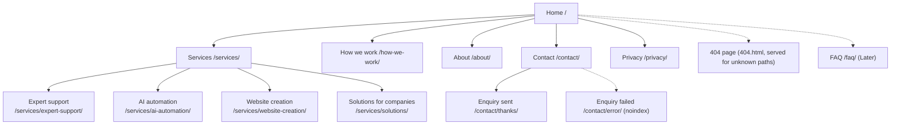

# Sitemap

Status: v3, updated with PRD v3 · Owner: UX/UI Designer · Tickets: #12, #122
Inputs: `docs/product/PRD.md` (sections 4, 5, 6, 8), `docs/product/personas.md`, `docs/product/success-metrics.md`.
Flows and navigation diagrams: `user-flows.md`.

Personas: **P1** individual who needs an expert, **P2** company that needs AI automation, **P3** company that needs a website, **P4** company that needs a solution or expert help.
Tags: **MVP** = p0/p1 in the PRD, needed for go-live. **Later** = p2/p3.
The site-wide CTA label is **"Book a call"**. The Expert support page's in-page CTA, and that service's card wherever the four services are shown, read **"Book an expert"** (PRD section 6). The header always reads "Book a call". On the Contact page the submit button reads "Send message".

## Structure

Two-click rule (FR-8): every page is reachable from Home in at most two clicks. Service detail pages are two clicks (Home, Services, detail), and also reachable from Home's service list in one.

URL rules (NFR-SEO-5): lowercase, hyphenated, trailing slash, no dates, IDs or brand name. Slugs are stable so a domain change needs only redirects. The earlier service URLs were never on a production domain, so they need no redirects.

## Page inventory

| Page | URL | Purpose | Persona | Primary CTA | Tag |
|------|-----|---------|---------|-------------|-----|
| Home | `/` | Say what we do, for whom and the next step in under 10 s; show the four services and the AI demo; repeat the CTA. Section order in PRD section 5.1 | All | Book a call | MVP (p0) |
| Services overview | `/services/` | The four services as one place, each with its example screens; link to detail | All | Book a call | MVP (p0) |
| Expert support | `/services/expert-support/` | What you get from an expert, how a session works, who it is for, example screens | P1, P4 | Book an expert | MVP (p1) |
| AI automation | `/services/ai-automation/` | AI agents and automations in real workflows: what you get, how it works, who it is for, example screens | P2 | Book a call | MVP (p1) |
| Website creation | `/services/website-creation/` | Websites and web apps, designed and built: what you get, how it works, who it is for, example screens | P3 | Book a call | MVP (p1) |
| Solutions for companies | `/services/solutions/` | Tailored software and technical solutions: what you get, how it works, who it is for, example screens | P4 | Book a call | MVP (p1) |
| How we work | `/how-we-work/` | Steps from first call to delivery, how a session and a project each run, pricing stance (CR-4) | All | Book a call | MVP (p1) |
| About | `/about/` | Who is behind the company, founders, expertise. Owner-supplied facts only; no story about the name | All | Book a call | MVP (p1) |
| Contact | `/contact/` | The conversion page: enquiry form, fallback contact method, response-time promise | All | Send message | MVP (p0) |
| Enquiry sent | `/contact/thanks/` | On-page confirmation, expected response time, what happens next. Reached via `303` after a successful non-JS submit; with JS the confirmation shows inline and this URL is the same content | All | None (links: How we work, Home) | MVP (p0) |
| Privacy notice | `/privacy/` | What is collected (enquiry data, analytics) and why (CR-6) | All | None | MVP (p0) |
| Enquiry failed | `/contact/error/` | No-JS fallback only: plain-language message that the enquiry was not sent and the text was not kept, the fallback contact, a link back to the form. `noindex`, not in the sitemap | All | Back to the form | MVP (p0) |
| 404 | `404.html` (the host serves it for unknown paths; not a routable URL, no trailing-slash rule) | Recover lost visitors | All | Back home, Contact | MVP (p0) |
| FAQ | `/faq/` (or a section on How we work) | Pricing, timeline, process, ownership answers | All | Book a call | Later (p2) |
| Blog, case studies, client portal, apps | n/a | Future | n/a | n/a | Later (p3), no URL reserved |

Non-page files: `sitemap.xml`, `robots.txt`, OG image. Non-production builds are `noindex`. The 404 page, `/contact/thanks/` and `/contact/error/` are `noindex` and excluded from `sitemap.xml`.

`[[PLACEHOLDER: Q4 Cal.com booking link; until it exists, every CTA goes to /contact/]]`
`[[PLACEHOLDER: Q22 real stories; the stories section on Home renders nothing until they exist (FR-5)]]`

## Navigation

**Header** (all pages, sticky on desktop, collapsing menu below 768 px):
Logo (to Home) · Services · How we work · About · **Book a call** (button, links to `/contact/`).
The Services sub-list is a disclosure (`
` or a button with `aria-expanded`) opened by click or tap, not by hover alone, plus an "All services" link. The Services label itself always links to `/services/` so it works without JS. If a hover-open is added, it must meet WCAG 1.4.13 (dismissible, hoverable, persistent). Escape-to-close is an optional JS enhancement. Contact is reached via the CTA button, not a separate text link, so there is one label for one action.

**Footer** (all pages):
- Column 1: logo, one-line description, config-driven contact method (email or link; hidden until it exists).
- Column 2: Services (four links).
- Column 3: Company (How we work, About, Contact).
- Bottom row: Privacy notice, copyright with brand name from config, "India · working with clients worldwide" (Q8), GitHub and Medium links from config (Q8). No registered-entity number until registered (Q9).
- Footer repeats the primary CTA in a closing band above the columns on all pages except Contact, Enquiry sent, Enquiry failed, Privacy (and other legal pages) and the 404 page.

**Breadcrumbs:** on service detail pages (Home > Services > name) with BreadcrumbList structured data. Not used elsewhere.

**Active state:** current section marked with `aria-current="page"` and a non-colour indicator (underline).

**In-page CTA placement (FR-1):** header button on every page, plus at least one closing CTA section on every content page. Home has an additional CTA in the hero. A service page's CTA carries the service to the contact path, so the enquiry records it (FR-9).

## Page states

| Page or element | Loading | Empty | Error |
|-----------------|---------|-------|-------|
| Static content pages | Server-rendered HTML; no spinner. Fonts use swap with a matched fallback so layout does not shift | n/a | n/a |
| Contact form | Submit button shows "Sending…", is disabled and `aria-busy`; form fields stay filled | n/a | Field errors inline under each field, linked with `aria-describedby`, summary at the top focused on submit failure. Network or server failure: message "We could not send this. Your text is still here. Try again or use [fallback contact]", form content preserved (JS path only). No-JS: native constraint validation (`required`, `type="email"`, `maxlength`) is the first check; if the server rejects the submission or delivery fails, the handler answers `303` to the static `/contact/error/`, and the text is not kept. Redirect targets are fixed absolute URLs built from `site.config.ts` url, never read from the request (no open redirect) |
| Contact success | n/a | n/a | n/a (see thanks page) |
| Fallback contact method | n/a | Hidden when config has no email or link; the form is then the only route and the copy does not mention the missing one | n/a |
| Stories section on Home | n/a | Component renders nothing until real stories exist (FR-5) | Not applicable |
| Social links | n/a | Hidden when none supplied | n/a |
| Service menu (JS) | n/a | n/a | Without JS the Services link goes to the overview, which lists all four |
| 404 | n/a | n/a | Plain-language message, link to Home, Services and Contact, no search needed at this size |
| Server error (5xx) | n/a | n/a | No 500 page in v1: static files never return 5xx from our code. Handler failures use the form error state (JS) or `/contact/error/` (no JS) |

## Legal pages

- **Privacy notice** (MVP p0): content follows the real data flow: the enquiry form destination (Q4) and Cloudflare Web Analytics (Q10). It names the brand from config and India (Telangana) jurisdiction, with no registered-entity number until registered (Q9).
- **Cookie information:** folded into the privacy notice. A banner is added only if the chosen tools need consent (NFR-SEC-2); the default design has none.
- **Terms of service:** not required at launch unless the owner asks (Q9); no URL reserved.

## Open questions affecting the sitemap
Q4 (booking link), Q8 (GitHub and Medium URLs) and Q22 (real stories). All are tracked in PRD section 12; none are answered here.
