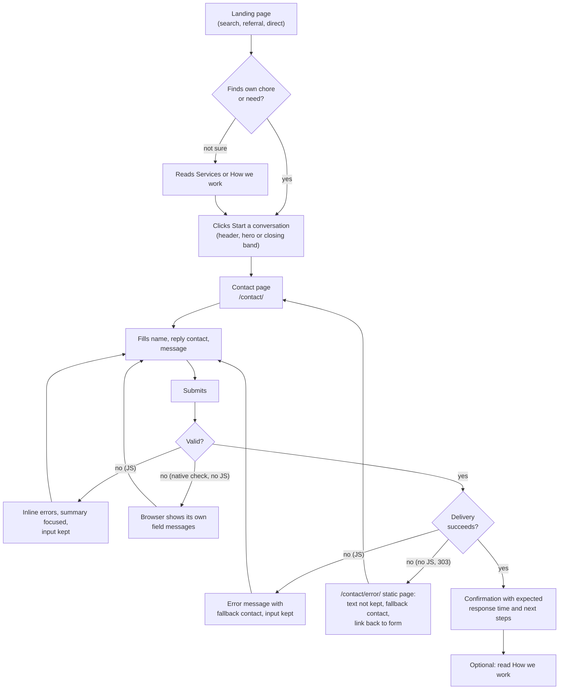
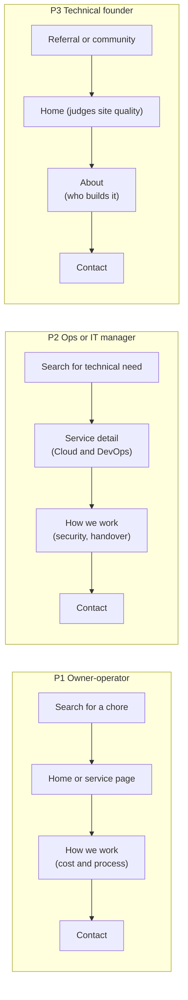
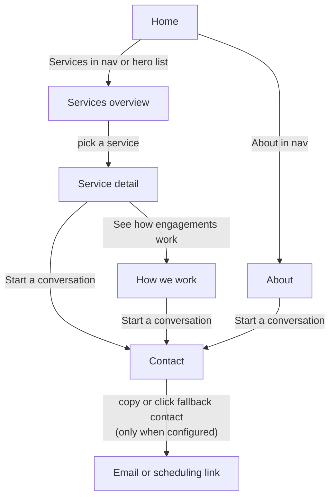
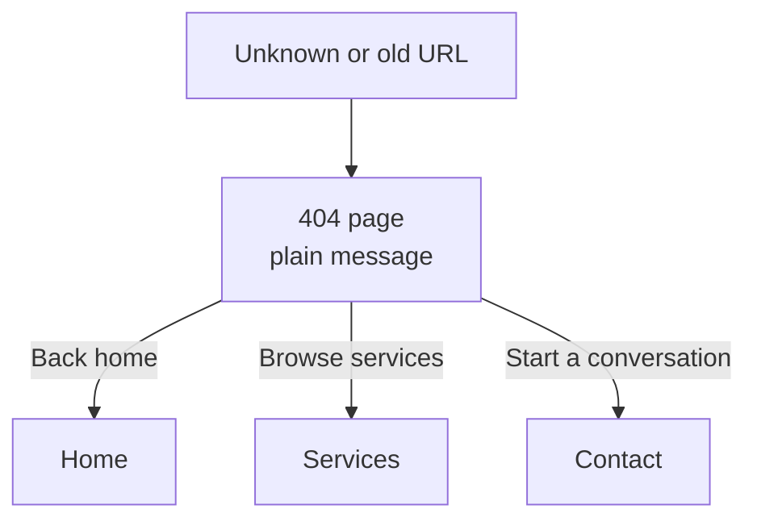
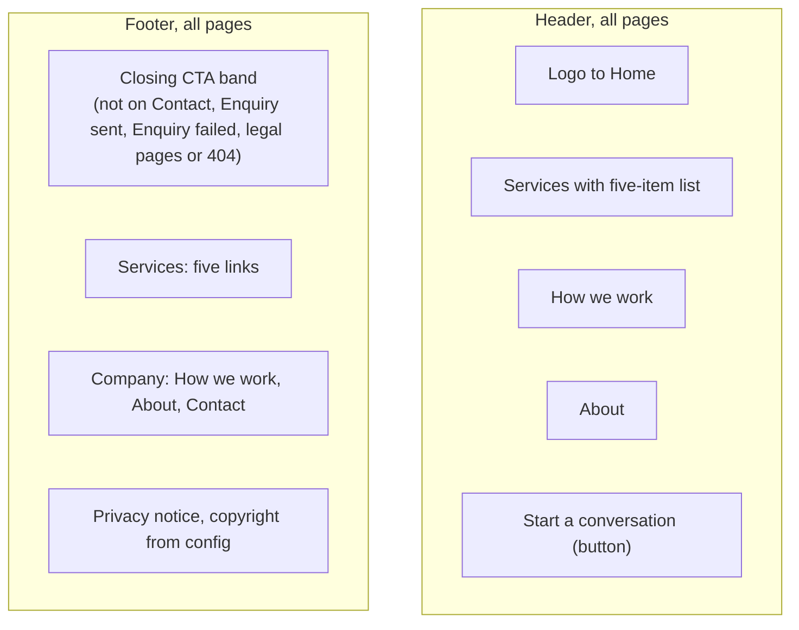

# User flows

Status: draft for Gate 2 · Owner: UX/UI Designer · Ticket: #12
Pages and URLs: `sitemap.md`. Personas: `docs/product/personas.md`.

## 1. Primary conversion: Start a conversation

PRD section 6: one primary conversion, an enquiry (name, reply contact, short description). It must work without a Clockvane mailbox and always give an on-page confirmation with an expected response time.
`[[PLACEHOLDER: Q4 form vs book-a-call link; promised response time]]`

Notes:
- Entry points: header button (every page), hero (Home), closing CTA band (every content page), footer band.
- Spam resistance is invisible (honeypot and server checks), no CAPTCHA by default (FR-2).
- Without JS the form posts normally after native constraint validation (`required`, `type="email"`, `maxlength`). The enquiry handler (Worker, separate origin) answers `303` to `/contact/thanks/` on success, or to the static `noindex` page `/contact/error/` if the server rejects the submission or delivery fails. That page says the text was not kept, shows the fallback contact and links back to the form. Redirect targets are fixed absolute URLs built from `site.config.ts` url, never from request fields. Only the JS path keeps input.
- Analytics events (success-metrics): contact page view, submit success. Funnel: CTA click, contact view, submit.

## 2. Persona journeys

## 3. Secondary flows

## 4. Recovery: 404

## 5. Navigation structure

Mobile: header collapses to logo, CTA button and a menu button below 768 px. The menu is a no-JS `
` disclosure (or a button with `aria-expanded`) opening a full-width panel with the same items in the same order, closed by the menu button. Focus order follows the panel and is not trapped; Escape returns focus to the menu button (optional JS enhancement, not in v1). The CTA button sits inside the panel and, from 480 px up, also beside the menu button (wireframes.md §0; below 480 px is a Gate 2 decision, update this line to match the outcome).

## 6. Interactive states per flow step

| Step | Loading | Empty | Error |
|------|---------|-------|-------|
| Contact submit | Button "Sending…", disabled, `aria-busy` | Required fields marked; no placeholder-only labels | Inline field errors plus focused summary; delivery failure keeps input and shows fallback contact |
| Confirmation | Inline message with focus moved to it (JS) or thanks page (no JS) | n/a | Direct visit to `/contact/thanks/` shows the same neutral confirmation text without claiming a submission; link back to Contact |
| Fallback contact | n/a | Hidden if not configured | n/a |
| Menu (mobile) | n/a | n/a | Without JS, the menu is a visible link list under the logo |
