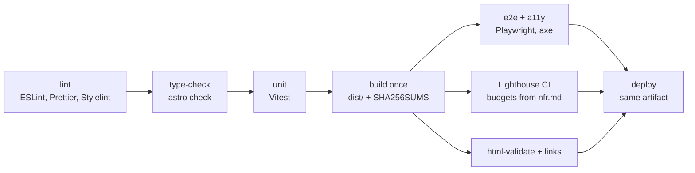

# CI/CD design

Status: design for Gate 2. Implementation tickets follow in Sprint 0. Host: Cloudflare Pages ([ADR-002](../adr/ADR-002-hosting.md)).
Stack and commands: [ADR-001](../adr/ADR-001-stack.md). Budgets: [nfr.md](../architecture/nfr.md).

## Principles
1. **Build once, deploy the same artifact everywhere.** One `build` job per commit produces `dist/` plus `SHA256SUMS`.
2. **Least privilege.** Workflow default `permissions: {}`; each job grants only what it needs.
3. **Pinned actions.** Third-party actions use a full commit SHA with a version comment (`uses: owner/action@<40-char-sha> # v4.2.1`). Dependabot updates them.
4. **Host specifics are confined** to `.github/workflows/deploy-*.yml` and `infra/`. Quality jobs never know the host.
5. **Production deploys use `environment: production`**, so the owner approves in GitHub.
6. No `pull_request_target` with untrusted code; fork PRs run quality jobs only and get no secrets and no deploy.
7. Every workflow sets `concurrency` (cancel superseded PR runs; never cancel a production deploy).

## Pipeline stages

| # | Job | What it runs | Needs | Permissions | Fails when |
|---|-----|--------------|-------|-------------|------------|
| 1 | `lint` | `npm run lint` (ESLint, Prettier check, Stylelint), `actionlint` on workflows, secret scan (gitleaks) | – | `contents: read` | any finding |
| 2 | `typecheck` | `npm run check` (`astro check`, `tsc --noEmit`) | – | `contents: read` | any error |
| 3 | `unit` | `npm test` (Vitest) with coverage report; enquiry handler under a Workers-like runtime | – | `contents: read` | failure or coverage drop on changed files |
| 4 | `build` | `npm run build`; writes `SHA256SUMS`; uploads artifact `site-<sha>` (retention 90 days for `main` runs, 14 for PR runs) | 1-3 | `contents: read` | build error; budget breach (page weight, JS) |
| 5 | `e2e-a11y` | downloads artifact, serves `dist/` statically, Playwright (Chromium only) plus `@axe-core/playwright` on every page; the header test runs against previews | 4 | `contents: read` | failed flow, any axe WCAG 2.2 AA violation |
| 6 | `lighthouse` | downloads artifact `site-<sha>`; `npm run test:dist` (no inline `<script>` except JSON-LD, ADR-004) when present; `npm run test:lighthouse` (`lhci autorun`, mobile, 3 runs, pages listed in `tests/e2e/lighthouserc.cjs`); writes scores and per-page JS/CSS/font/total sizes to the job summary; uploads `.lighthouseci/` as `lighthouse-<sha>` (14 days) | 4 | `contents: read` | score ≥ 95 or LCP/CLS/TBT limit not met; inline script found |
| 7 | `html-links` | `html-validate`, internal link check, sitemap/robots/OG presence | 4 | `contents: read` | any broken link or invalid HTML |
| 8 | `deploy-*` | see environments; runs only after 5-7 are green | 4-7 | `contents: read`, `deployments: write`, `pull-requests: write` (preview comment only) | deploy or smoke test fails |

Jobs 1-3 run in parallel; 5-7 run in parallel after `build`. Target wall time for a PR: under 8 minutes.
GitHub Actions minutes are unlimited on public repositories; if the repo ever goes private, the Free plan has 2,000 minutes a month, and the concurrency cancel rules above keep usage low.

## Environments and triggers
| Environment | Trigger | Workflow | Approval | What happens |
|---|---|---|---|---|
| preview | `pull_request` (same-repo) builds in `ci.yml`; `workflow_run` of `ci.yml` triggers `deploy-preview.yml` (runs the copy on `main`, so PR code never sees the token; the artifact is data only) | `ci.yml` → `deploy-preview.yml` | none | deploy the PR's artifact to branch `pr-<N>`; comment the URL on the PR; run header + smoke test; delete deployment on PR close |
| staging | `push` to `main` | `ci.yml` → `deploy-staging.yml` | none | rebuild is **not** done: the main-branch run's artifact is deployed to `staging`; E2E and Lighthouse re-run against the live staging URL |
| production | `push` of tag `v*.*.*` excluding pre-releases (`tags: ['v*.*.*', '!v*-*']`, plus a job `if:` guard that rejects any tag containing `-`) | `release.yml` | **owner, via `environment: production`** | find the successful `main` run for the tagged commit, download its artifact, verify `SHA256SUMS`, deploy to the production branch, smoke test |

Notes:
- The tag workflow fails closed if no green `main` run exists for the tagged SHA. That guarantees staging tested the exact bytes that reach production.
- Only commits reachable from `main` may be released: the first step checks `git merge-base --is-ancestor <tag-sha> origin/main`.
- Environment-specific headers and `noindex` are generated at deploy time from `infra/headers`; the artifact has no environment flag (ADR-002).
- Required reviewers and the tag restriction on `production` are configured by the owner (see Secrets).

## Caching
| What | How | Key |
|---|---|---|
| npm packages | `actions/setup-node` with `cache: npm` | hash of `package-lock.json` |
| Playwright browsers | `actions/cache` on `~/.cache/ms-playwright` | Playwright version from the lockfile |
| Astro image cache | `actions/cache` on `node_modules/.astro` | lockfile hash + content hash, restore-keys fallback |
| Build output | not cached; it is the artifact | commit SHA |
Caches never hold secrets and are read-only for fork PRs.

## Required checks (branch ruleset on `main`, set by the owner)
`lint`, `typecheck`, `unit`, `build`, `e2e-a11y`, `lighthouse`, `html-links`, plus the agent review statuses. `deploy-preview` is not required (fork PRs never deploy, so it would never report); it is still expected on same-repo PRs. Branches must be up to date;
no direct pushes; dispatcher merge only. Use the job names above verbatim so the ruleset keeps working.

## Rollback
Target: ≤ 15 minutes (nfr O-4).
1. **Preferred, 2 min:** run workflow `rollback.yml` (manual `workflow_dispatch`, input: a previous tag). It runs under `environment: production`, so the owner approves, downloads that tag's retained artifact and redeploys it. No rebuild.
2. **Fallback:** in the Cloudflare dashboard, *Deployments → previous production deployment → Rollback*.
3. **If the artifact has expired** (90 days): re-run `release.yml` for the old tag; it rebuilds from the tag, and the checksum differs, so record why in the release notes.
4. After a rollback, open an issue for the cause and fix forward with a patch release. Never delete or move a published tag.

## Secrets, variables and where they live
Secrets are added by the owner, never by agents. Nothing goes in the repo or in `.env*` files.

| Name | Kind | Scope | Used by | Notes |
|---|---|---|---|---|
| `CLOUDFLARE_API_TOKEN` | secret | environments `preview`, `staging`, `production` | deploy workflows | Scopes: Pages Edit, Workers Scripts Edit. Account-wide: Cloudflare cannot scope it to a branch or project, so protection comes from `workflow_run` preview deploys, environment branch/tag restrictions and CODEOWNERS on workflows (ADR-002 Authentication). Optional hardening: a second Cloudflare account for production. Rotate every 90 days |
| `CLOUDFLARE_ACCOUNT_ID` | secret | the same three environments | deploy workflows | Not very sensitive, kept as a secret for tidiness |
| `CF_PAGES_PROJECT` | variable | repository | deploy workflows | Project name, e.g. `clockvane-website` |
| `SITE_URL_PRODUCTION` | variable | repository | build | Read only by `site.config.ts`, which falls back to the default URL defined in that file; no other code reads it (rule 5). Set it only if the URL must differ from the default |
| `ENQUIRY_*` (delivery destination, keys) | Worker secrets | Cloudflare, set by the owner via `wrangler secret put` or the dashboard | enquiry worker | Defined after PRD Q4 |
| `LHCI_GITHUB_APP_TOKEN` | secret, optional | repository | lighthouse | Only if we adopt the LHCI GitHub app for status checks; not needed for the artifact-based design |
| `GITHUB_TOKEN` | automatic | per job | all | Permissions narrowed per job as above |

OIDC is used wherever the target supports it. Cloudflare's API does not, so the token is an environment secret. On the exit target (GCP), Workload Identity Federation removes it.

## Observability on free tiers
- **Uptime:** an external free monitor (UptimeRobot or Cloudflare Health Checks) checks `/` and the enquiry worker `/health` every 5 min and emails the owner. Account creation is the owner's (`needs-human`), after Gate 3.
- **Lighthouse history:** `lighthouse` uploads reports as artifacts on every PR. A scheduled weekly workflow (`lhci-history.yml`) runs LHCI against production, appends scores to `metrics/lighthouse.json` on the `lhci-history` branch, and opens an issue if any score drops under 95.
- **Dependencies:** `.github/dependabot.yml` for `npm` and `github-actions`, weekly, grouped by minor/patch, security updates immediately. CI must be green to merge; major upgrades get their own ticket.
- **Security alerts:** enable Dependabot alerts, secret scanning and push protection (free on public repos; owner toggles in Settings → Code security).
- **Deploy visibility:** the GitHub Deployments tab shows each environment's current commit and approver.

## Implementation backlog (for the EM to ticket)
1. `ci.yml` stages 1-7 with caching and artifact (DevOps engineer).
2. `infra/headers` + `infra/cloudflare/` adapter and `deploy-preview.yml`, `deploy-staging.yml`.
3. `release.yml`, `rollback.yml`, release notes automation.
4. Dependabot, `lhci-history.yml`, `actionlint` in CI.
5. Enquiry worker stub and tests (after the stack scaffold).
