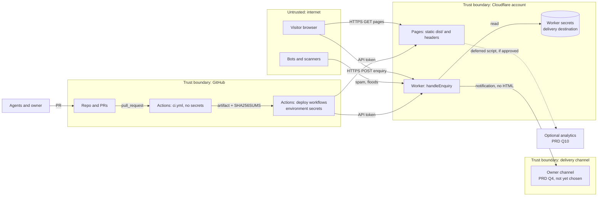

# Threat model

Status: proposed for Gate 2 · Scope: marketing site, contact form pipeline, third-party scripts, CI/CD and
hosting accounts · Inputs: ADR-001 (Astro static + `handleEnquiry`), ADR-002 (Cloudflare Pages + one Worker),
`docs/architecture/nfr.md` §6, `docs/devops/cicd.md`. Method: STRIDE-lite (Spoofing, Tampering, Repudiation,
Information disclosure, Denial of service, Elevation of privilege).

Follow-up tickets do not exist yet. Rows say `NEW-n`; the EM creates the tickets from the list at the end and the
numbers are then filled in.

## System and data flows

Trust boundaries: (1) internet to Cloudflare edge; (2) Worker to the delivery channel; (3) PR code to the
privileged deploy workflows (the `workflow_run` split in ADR-002); (4) our origin to any third-party origin.

## Assets
| Asset | Why it matters |
|---|---|
| Site integrity (`dist/`, headers) | Defacement, malicious JS or redirects damage a company selling trust |
| Lead data (name, reply contact, message) | Personal data; DPDP and GDPR duties (see `privacy.md`) |
| Cloudflare API token, GitHub account(s) | The token deploys anywhere in the account, production included |
| Delivery destination (Worker secret) | Leak enables spam to, or impersonation of, the owner's channel |
| Domain and DNS (when bought) | Takeover redirects all traffic and email |
| Brand reputation | Spam relay or phishing from our name |

## Threats (STRIDE-lite)
L = likelihood, I = impact (H/M/L).

| # | Component | Threat | Type | L | I | Mitigation | Ticket |
|---|---|---|---|---|---|---|---|
| T1 | Contact form | Bot spam floods the owner's channel | D | H | M | Honeypot field, minimum-time check, Zod length limits, 10 kB body cap (SEC-8); per-IP rate limit via Cloudflare rate limiting rule or Worker check; daily cap on deliveries as a circuit breaker; Turnstile only if spam persists (decision to owner) | NEW-1 |
| T2 | Contact form | Handler abused as a relay: header or HTML injection into the notification (e.g. newline in name) | T/E | M | H | Server validation rejects control characters; output is plain text, never HTML; user values never go into headers, subject or URLs unescaped; unit tests with injection payloads | NEW-1 |
| T3 | Contact form | Cross-origin POST from another site (form lives on Pages, handler on a Worker origin) | S | M | L | Check `Origin`/`Referer` against the `site.config.ts` allow-list; no cookies or ambient credentials exist, so CSRF has no session to ride; strict CORS (specific origin, `POST` only) | NEW-1 |
| T4 | Contact form | PII leaks through logs, error pages or analytics | I | M | H | No request bodies or contact values in logs; log only a request id, status and reason code; generic error messages with fallback contact; Worker logs/observability set to metadata only | NEW-1 |
| T5 | Contact form | Oversized or malformed requests exhaust Worker CPU | D | M | L | Content-Length and streamed size cap before parsing; reject non-`application/x-www-form-urlencoded` / JSON early; Worker free quota (100k req/day) is a hard cap, so also see T6 | NEW-1 |
| T6 | Worker quota | Attacker burns the 100k/day free quota; legitimate enquiries fail | D | M | M | Static pages are not metered, so the site stays up; form shows the fallback contact on failure (architecture error state); alert via uptime monitor on `/health` | NEW-2 |
| T7 | Contact form | Visitor denies sending / owner cannot tell real leads from forgeries | R | L | L | Request id returned to the visitor and included in the notification; no authentication claimed | — accepted |
| T8 | Enquiry destination | Destination (webhook URL, chat id) leaks from repo or client bundle | I | L | H | Held only in Worker secrets (ADR-002); `site.config.ts` holds the public endpoint only; secret scanning + push protection; CI check that `dist/` contains no secret-looking strings | NEW-3 |
| T9 | Hosting | Defacement via a stolen Cloudflare/GitHub credential | T | M | H | 2FA on both accounts (hardware key or passkey for the owner); production deploy needs owner approval in the `production` environment; token rotated every 90 days; owner reviews Cloudflare audit log monthly | NEW-3 |
| T10 | Hosting | Missing or wrong headers on a host (e.g. Worker responses do not get Pages `_headers`) | T | M | M | `infra/headers` is the single source; header test runs against preview and staging, and against the Worker route; see `headers.md` | NEW-4 |
| T11 | Third-party scripts | A script supplier is compromised or adds trackers | T/I | M | H | No third-party script at launch. Anything new needs a written justification (NFR-PERF-2), a CSP update in the same PR, security review, and SRI where the supplier serves versioned files. Fonts, images and the form script are self-hosted | NEW-4 |
| T12 | Site content | XSS via content or query strings | T/E | L | H | Static HTML; no `set:html`/`innerHTML` of untrusted data; strict CSP with no `unsafe-inline`; lint rule against `set:html` with non-literal input | NEW-4 |
| T13 | Dependencies | Malicious or vulnerable npm package (typosquat, hijacked maintainer, install scripts) | T/E | M | H | Committed lockfile, `npm ci`, `npm audit --omit=dev` in CI (reachable issues only), Dependabot weekly grouped, new deps justified in PR, `ignore-scripts=true` in CI install where tooling allows, few deps by design (ADR-001) | NEW-5 |
| T14 | CI/CD | Untrusted PR code reaches deploy token (e.g. PR edits workflow, `pull_request_target` misuse) | E | M | H | ADR-002 design: `ci.yml` has no credentials; deploys run from `workflow_run` on `main`; artifact treated as data and verified by `SHA256SUMS`; forbid `pull_request_target` checkout of PR code; environments restricted to `main` / tags `v*` | NEW-5 |
| T15 | CI/CD | Compromised third-party GitHub Action | T | M | H | Pin every third-party action to a full commit SHA with version comment; Dependabot updates; prefer few, well-known actions; default `permissions: contents: read`, widen per job | NEW-5 |
| T16 | CI/CD | Malicious workflow change merged to `main` uses the account-wide token (residual risk named in ADR-002) | E | L | H | CODEOWNERS owner review of `.github/workflows/**`; branch ruleset; fallback hardening: a separate production Cloudflare account/token | NEW-5 (human: ruleset) |
| T17 | CI/CD | Secrets committed or echoed in logs | I | M | H | Secret scanning + push protection on (human setting, SEC-10); gitleaks (or equivalent) step on PR diff; agents never read `.env*`; no `set -x` around secrets | NEW-3 |
| T18 | Agent workflow | A prompt-injected issue/PR text steers an agent to leak data or weaken controls | E | M | M | Agents cannot touch governance files or secrets (CLAUDE.md rules 4, 7); every PR is independently reviewed; security-sensitive label for header, workflow and form changes | — existing process |
| T19 | Domain and DNS | Registrar or DNS takeover; dangling `*.pages.dev` or CNAME after a host move | S/T | L | H | 2FA and registrar lock on the domain; auto-renew; remove DNS records when a project is deleted (exit plan step 6); HSTS only after HTTPS works everywhere | NEW-6 (post-domain) |
| T20 | Previews | Preview/staging URLs indexed or used for phishing; previews expose unreleased content | I | M | L | `noindex` + disallow-all robots (ADR-002); previews hold no secrets or real endpoint destination; torn down on PR close | NEW-4 |
| T21 | Analytics (if added) | Visitor tracking without a legal basis; analytics script becomes a supply-chain entry | I/T | M | M | Cookieless, no cross-site tracking, ID in config; decision gated on PRD Q10; CSP origin added in the same PR as the script | NEW-4 |
| T22 | Brand | Phishing mail or sites imitate Clockvane | S | M | M | When email exists: SPF, DKIM, DMARC (`p=none` then `quarantine`); security.txt (see below) | NEW-6 |

### Proposed tickets
- **NEW-1** Enquiry handler hardening: validation, anti-spam, Origin check, rate limit, log hygiene, injection tests (SDE; security review).
- **NEW-2** Uptime monitor and quota alert for the Worker (DevOps, operate).
- **NEW-3** Secret hygiene: secret scanning/push protection (human settings), CI gitleaks step, `dist/` secret grep, 2FA checklist for the owner.
- **NEW-4** `infra/headers` implementation, header tests on preview/staging/Worker, no-third-party-script guard (DevOps/SDE).
- **NEW-5** CI/CD hardening: SHA pinning check, `permissions:`, no `pull_request_target`, Dependabot, `npm audit` job; governance issue for CODEOWNERS and ruleset (DevOps; `needs-human`).
- **NEW-6** Domain-day checklist: registrar lock, DNS, SPF/DKIM/DMARC, HSTS preload decision, `/.well-known/security.txt` with the real contact.

## Baseline controls
- Security headers and CSP: `headers.md`.
- Form: server-side validation, spam protection, rate limits, no PII in logs (T1–T5).
- Supply chain: pinned action SHAs, least-privilege tokens, Dependabot, lockfile, secret scanning (T13–T17).
- Accounts: 2FA on GitHub, Cloudflare and registrar; environment-scoped secrets; production approval (T9, T19).

## Residual risks proposed for the owner to accept
1. **Account-wide Cloudflare token** (ADR-002): a malicious change merged past review could deploy to production. Mitigated, not removed. Option: second free Cloudflare account for production.
2. **Free-tier Worker quota** can be exhausted by a determined attacker; the site stays up but the form falls back to the displayed contact method.
3. **Honeypot and time-trap** stop commodity bots, not targeted humans; Turnstile is the next step if needed.
4. **No WAF tuning** beyond free-plan defaults.
5. **Placeholder destination** (PRD Q4): until the owner chooses a channel the handler is a stub; the threat analysis for the real channel (e.g. webhook trust, delivery failure alerts) must be revisited when it is chosen.

## Out of scope
Penetration testing, implementing the controls above, and legal advice (see `privacy.md`).
